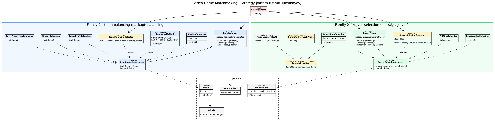

# Assignment 5 — Strategy Pattern: **Video Game Matchmaking**

**Student:** Damir Tuleubayev (SE-2535)  **Domain:** #16 Video Game Matchmaking (same as Assignment 4)  **Stack:** Java 17+, Maven, JUnit 5, JaCoCo

In matchmaking two operations can be done in several different ways, so each is a **strategy family**:

| Family | Interface | Strategies (different logic, not different numbers) | Context | Selector |
|---|---|---|---|---|
| 1. Split a lobby into two teams | `TeamBalancingStrategy` | Snake draft · Greedy · Party preserving · Random | `TeamBalancer` | `TeamBalancingSelector` |
| 2. Pick a game server for a party | `ServerSelectionStrategy` | Lowest ping · Least loaded · Fill first | `ServerPicker` | `ServerSelectionSelector` |

---

## 1. Quick start

```bash
mvn test                                   # all unit tests + JaCoCo report (target/site/jacoco/index.html)
mvn package                                # builds target/strategy-demo.jar
java -jar target/strategy-demo.jar         # demo
java -jar target/strategy-demo.jar --at 03:00   # demo pretending it is 03:00 (selector rules depend on the hour)
```

The demo prints:
1. **the same input through every strategy** of each family (same lobby → 4 team splits, same party → 3 servers);
2. **manual choice vs. automatic choice** by each Selector (for every game mode, and for 03:00 / 13:00 / 20:30 / now);
3. **switching the strategy at runtime** with `setStrategy(...)` on both contexts.

---

## 2. The strategies

### Family 1 — team balancing (`balancing` package)

| Strategy | How it works |
|---|---|
| `SnakeDraftBalancing` | Sort by rating, draft in the order BLUE, RED, RED, BLUE, BLUE, RED… like captains picking players. |
| `GreedyBalancing` | Sort by rating, give each next player to the team whose total rating is lower (while it has room). Smallest gap. |
| `PartyPreservingBalancing` | Group premade parties into blocks, place the biggest blocks first into the weaker team with room. Friends stay together. |
| `RandomBalancing` | Ignore ratings, shuffle with a seed, cut in half. For fun custom games. |

### Family 2 — server selection (`server` package)

| Strategy | How it works |
|---|---|
| `LowestPingSelection` | Asks the `LatencyProvider` for every player's ping to every server with room, picks the lowest average. |
| `LeastLoadedSelection` | Picks the server with the smallest *share* of used slots — spreads the crowd. |
| `FillFirstSelection` | Best-fit packing: picks the server that will be left with the fewest free slots, so other servers stay empty and can be switched off. |

### Selectors (the only place with `if` on the situation)

| Selector | Rules |
|---|---|
| `TeamBalancingSelector.choose(mode, lobby)` | CUSTOM → Random · RANKED → Greedy · CASUAL with a premade party → Party preserving · CASUAL all solo → Snake draft |
| `ServerSelectionSelector.choose(mode)` (clock injected) | RANKED → Lowest ping (any time) · 18:00–23:59 → Least loaded · 00:00–06:59 → Fill first · otherwise → Lowest ping |

The contexts (`TeamBalancer`, `ServerPicker`) receive a strategy in the constructor, can replace it with `setStrategy()`, and only delegate — no `if`/`switch`/`instanceof` on the strategy type. A brand-new strategy plugs in without changing any existing class (see `TeamBalancerContextTest.aNewStrategyWorksWithoutChangingTheContext`) — Open/Closed Principle.

### Isolating from change (Clean Code ch. 10)

`LowestPingSelection` needs **external data** — live ping. It never talks to a network probe directly; it depends on our own interface **`LatencyProvider`** (like `PortfolioManager` → `StockExchange` on slide 43):

* `SimulatedNetworkProbe` — the "real" source for the demo: base ping by region pair + 0–14 ms stable jitter, no real network.
* `FixedLatency` (test code) — a fake that returns exactly the values written in the test, so tests are repeatable.

Swapping the data source (e.g. a real ICMP probe) means writing one new `LatencyProvider` class; no strategy changes. The selector also gets its time from an injected `java.time.Clock` for the same reason.

---

## 3. Classes and responsibilities (one sentence, max 25 words)



| Class | Responsibility |
|---|---|
| `Player` | Holds one lobby member's nickname, rating, party id. |
| `Teams` | Holds the two finished teams with their rating totals. |
| `GameMode` | Names the kind of match a lobby queues for. |
| `LobbyRules` | Rejects invalid input before any strategy runs. |
| `TeamBalancingStrategy` | Declares the contract for splitting a valid lobby into two teams. |
| `SnakeDraftBalancing` | Drafts players by rating in snake order. |
| `GreedyBalancing` | Gives each next strongest player to the weaker team. |
| `PartyPreservingBalancing` | Places whole premade parties as blocks, keeping friends on one team. |
| `RandomBalancing` | Shuffles the lobby with a fixed seed, then cuts it in half. |
| `RatingMath` | Sorts players by rating; sums team ratings. |
| `TeamBalancer` | Delegates lobby splitting to its current balancing strategy. |
| `BalancingMethod` | Gives legacy names to the built-in balancing strategies. |
| `TeamBalancingSelector` | Picks the balancing strategy suited to the game mode plus lobby makeup. |
| `GameServer` | Holds one server's region, capacity, free slots. |
| `ServerSelectionStrategy` | Declares the contract for choosing a server for a group. |
| `LowestPingSelection` | Chooses the fitting server with the lowest average player ping. |
| `LeastLoadedSelection` | Chooses the fitting server with the smallest share of used slots. |
| `FillFirstSelection` | Chooses the fitting server left with the fewest free slots. |
| `ServerPicker` | Delegates server choice to its current selection strategy. |
| `ServerSelectionSelector` | Picks the selection strategy suited to the game mode plus hour of day. |
| `LatencyProvider` | Hides where ping measurements come from. |
| `SimulatedNetworkProbe` | Produces simulated ping from region pairs plus stable jitter. |
| `StrategyDemo` | Shows every strategy, selector choices, runtime switching on the console. |

---

## 4. Refactoring with Git history

Family 1 was first written the "bad" way — all four algorithms inside one `TeamBalancer` class behind a `switch (method)` — and committed. Then it was refactored into Strategy and committed again. **`TeamBalancerTest` is the same file on both commits and passes on both** (it only uses the public API `new TeamBalancer(BalancingMethod.X).balance(lobby)` / `setMethod(...)`).

* **Before:** [`docs/before-refactoring/TeamBalancer.java.txt`](docs/before-refactoring/TeamBalancer.java.txt) — the original class with all four algorithms in one `switch` (commit `e876ad4` "BEFORE refactoring" in the development history).
* **After:** [`src/main/java/kz/tuleubayev/matchmaking/balancing/`](src/main/java/kz/tuleubayev/matchmaking/balancing/) — `TeamBalancer` is now a context, each `case` became its own strategy class (commit `1200809` "AFTER refactoring").
* The safety net: [`TeamBalancerTest`](src/test/java/kz/tuleubayev/matchmaking/balancing/TeamBalancerTest.java) is the same file in both versions and passes on both.

What changed: the `switch` disappeared; each `case` became its own class implementing `TeamBalancingStrategy`; `TeamBalancer` became a context holding a strategy. `BalancingMethod` survived only as a list of legacy names that create the built-in strategies, so old code and old tests keep working — a new strategy does not need a new constant.

---

## 5. Why Strategy, not State or Template Method

**Not State.** In State the object changes its *own* behaviour when its *internal* state changes, and the state objects usually know each other and trigger the transitions (QUEUED → LOCKED → FINISHED). Here nothing transitions: a snake-draft split never "becomes" a greedy split. The algorithm is chosen *from outside* — by the client or by a Selector looking at the game mode, the lobby or the clock — and every strategy is independent and unaware of the others. The context has no lifecycle; it is just "split this lobby with whatever algorithm you were given".

**Not Template Method.** Template Method fixes the skeleton of an algorithm in a base class and lets subclasses override some steps; the choice is made by *inheritance at compile time*, and you cannot swap it on a living object. My algorithms do not share a skeleton: snake draft sorts and drafts by position, party-preserving groups players into blocks, random shuffles and ignores ratings, fill-first does bin packing, lowest-ping calls an external data source. Forcing them into one base class would create empty or meaningless hook methods. With Strategy the algorithm is a separate object chosen by *composition at run time* (`setStrategy`), which is exactly what the Selector and the demo do.

So the intent is: **a family of interchangeable algorithms for the same job, chosen and swapped while the program runs** — that is the Strategy pattern.

---

## 6. Tests

`mvn test` → 62 test runs (JaCoCo ≈ 99 % line coverage of everything except the demo).

* **Every strategy** has its own test class (`SnakeDraftBalancingTest`, `GreedyBalancingTest`, `PartyPreservingBalancingTest`, `RandomBalancingTest`, `LowestPingSelectionTest`, `LeastLoadedSelectionTest`, `FillFirstSelectionTest`).
* **Every Selector rule** is tested (`TeamBalancingSelectorTest`, `ServerSelectionSelectorTest` with `Clock.fixed(...)`, including hour boundaries 06:59 / 07:00 / 17:59 / 18:00).
* **Parameterized tests** (`@ParameterizedTest` + `@MethodSource`): `AllBalancingStrategiesTest` — on every balancing strategy, every player ends up in exactly one team, team sizes are equal, the rating gap is never negative; `AllServerStrategiesTest` — every selection strategy only picks a listed server with room, and returns nothing when no server has room.
* **Fake external data:** `FixedLatency` returns fixed pings; `LowestPingSelectionTest.theAnswerFollowsTheExternalData` shows the choice changes when the data changes.
* **Context tests:** `TeamBalancerContextTest`, `ServerPickerContextTest` — runtime switching, a brand-new strategy works without touching the context.
* **Refactoring safety net:** `TeamBalancerTest` (unchanged since the "before" commit).

---

## 7. Project layout

```
src/main/java/kz/tuleubayev/matchmaking/
  model/       Player, Teams, GameMode, LobbyRules
  balancing/   TeamBalancingStrategy + 4 strategies, TeamBalancer (context), TeamBalancingSelector, BalancingMethod
  server/      ServerSelectionStrategy + 3 strategies, ServerPicker (context), ServerSelectionSelector,
               LatencyProvider, SimulatedNetworkProbe, GameServer
  app/         StrategyDemo
src/test/java/kz/tuleubayev/matchmaking/
  balancing/   tests + Lobbies (test data)
  server/      tests + FixedLatency (fake data source) + Servers (test data)
docs/          UML class diagram (.png, .svg, .dot)
```
